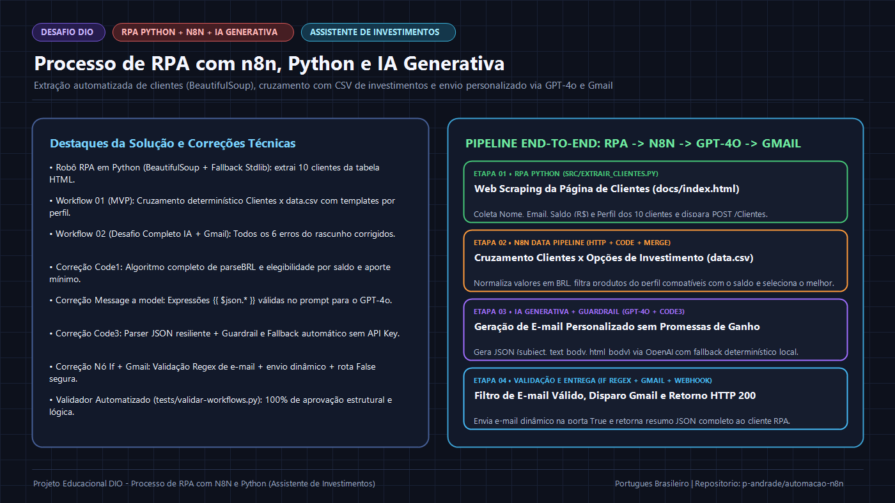
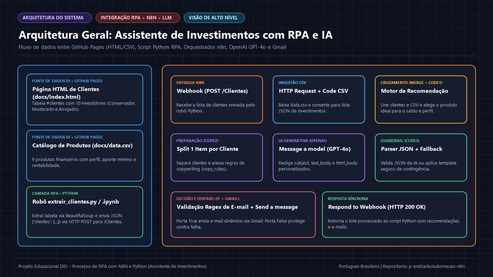
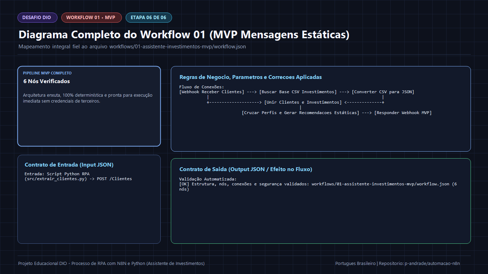
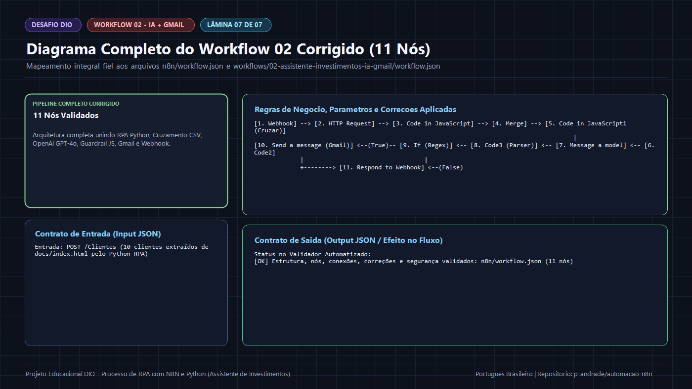

# 🚀 Desafio DIO — Processo de RPA com n8n, Python e IA Generativa (Assistente de Investimentos)



> **Entregas Principais do Desafio DIO:**
> - ⚙️ **Workflow Completo Corrigido (11 Nós — IA GPT-4o + Gmail):** [`n8n/workflow.json`](n8n/workflow.json) e [`workflows/02-assistente-investimentos-ia-gmail/workflow.json`](workflows/02-assistente-investimentos-ia-gmail/workflow.json)
> - ⚙️ **Workflow MVP (6 Nós — Mensagens Estáticas):** [`workflows/01-assistente-investimentos-mvp/workflow.json`](workflows/01-assistente-investimentos-mvp/workflow.json)
> - 🤖 **Robô RPA em Python (`BeautifulSoup` + Envio Webhook):** [`src/extrair_clientes.py`](src/extrair_clientes.py) e [`src/extrair_clientes.ipynb`](src/extrair_clientes.ipynb)
> - 🛠️ **Relatório Forense de Correção dos 6 Erros do Workflow Original:** [`docs/03-diagnostico-e-correcao-erros.md`](docs/03-diagnostico-e-correcao-erros.md)

---

## 📑 Sumário de Navegação

1. [Apresentação do Desafio](#-1-apresentação-do-desafio)
2. [Objetivo Geral e Objetivos Específicos](#-2-objetivo-geral-e-objetivos-específicos)
3. [Problema que o Projeto Resolve](#-3-problema-que-o-projeto-resolve)
4. [Diagnóstico e Correção dos 6 Erros do Workflow Original](#-4-diagnóstico-e-correção-dos-6-erros-do-workflow-original)
5. [Visão Geral da Solução](#-5-visão-geral-da-solução)
6. [Arquitetura do Projeto](#-6-arquitetura-do-projeto)
7. [Links para a Documentação Técnica (`docs/`)](#-7-documentação-técnica-completa)
8. [Prompts e Regras de Compliance Financeiro (`prompts/`)](#-8-prompts-e-regras-de-compliance-financeiro)
9. [Workflows n8n e Script Python RPA (`workflows/`, `n8n/`, `src/`)](#-9-workflows-n8n-e-script-python-rpa)
10. [Galeria de Diagramas e Imagens Didáticas (`assets/`)](#-10-galeria-de-diagramas-e-imagens-didáticas)
11. [Tecnologias e Ferramentas Utilizadas](#-11-tecnologias-e-ferramentas-utilizadas)
12. [Instruções para Importar os Workflows e Rodar o RPA](#-12-instruções-para-importar-os-workflows-e-rodar-o-rpa)
13. [Pré-requisitos e Configurações Necessárias](#-13-pré-requisitos-e-configurações-necessárias)
14. [Como Executar os Testes e Validações (`tests/`)](#-14-como-executar-os-testes-e-validações)
15. [Limitações Conhecidas e Transparência Técnica](#-15-limitações-conhecidas-e-transparência-técnica)
16. [Fontes Oficiais de Referência](#-16-fontes-oficiais-de-referência)
17. [Conclusão e Aprendizados](#-17-conclusão-e-aprendizados)
18. [Licença](#-18-licença)
19. [Entrega Oficial do Desafio DIO](#-19-entrega-oficial-do-desafio-dio)

---

## 📌 1. Apresentação do Desafio

Este repositório contém a solução completa, auditada e documentada para o desafio da **DIO (Digital Innovation One)**:

**Criando um Assistente de Investimentos com RPA e IA Generativa (Processo de RPA com N8N e Python)**

O projeto integra três camadas tecnológicas essenciais para o mercado financeiro:
1. **Extração Automatizada (RPA com Python):** Um robô que acessa a página HTML de clientes ([`docs/index.html`](docs/index.html)), extrai a tabela `#clientes` com `BeautifulSoup` (`nome`, `email`, `saldo`, `perfil`) e envia o lote via requisição HTTP `POST` para o Webhook do n8n.
2. **Orquestração e Elegibilidade Financeira no n8n:** Busca o catálogo de produtos ([`docs/data.csv`](docs/data.csv)), converte os saldos em Reais (`R$`) para valores numéricos e cruza o perfil de cada investidor (`Conservador`, `Moderado`, `Arrojado`) com o aporte mínimo exigido por cada ativo.
3. **Personalização com IA Generativa (`GPT-4o`) e Disparo via `Gmail`:** Redige e-mails curtos e personalizados respeitando regras de *compliance* (sem prometer ganhos ou garantias), valida o endereço de e-mail por expressão regular (`Regex`), realiza o envio pelo Gmail e retorna o relatório consolidado no `Respond to Webhook`.

---

## 🎯 2. Objetivo Geral e Objetivos Específicos

### Objetivo Geral
Desenvolver um pipeline funcional de ponta a ponta que automatiza a coleta de clientes via **RPA em Python**, o cruzamento inteligente de carteira no **n8n** e a geração de recomendações personalizadas com **IA Generativa**, além de documentar e corrigir todas as lacunas de código deixadas nas videoaulas de orientação do desafio.

### Objetivos Específicos
- **Resolver o `TODO` do script RPA em Python:** Implementar o envio HTTP `POST` da lista de 10 clientes para o endpoint `/Clientes` do n8n em [`src/extrair_clientes.py`](src/extrair_clientes.py) e [`src/extrair_clientes.ipynb`](src/extrair_clientes.ipynb).
- **Auditar e corrigir os 6 erros do workflow original do aluno:** Reconstruir os códigos JavaScript que não foram disponibilizados pelo instrutor nas videoaulas e corrigir expressões de prompt, validação Regex e parâmetros do Gmail.
- **Disponibilizar as duas versões do desafio (MVP + Desafio Completo IA):**
  - **Workflow 01 (MVP):** Mensagens estáticas por perfil, 100% independente de credenciais externas.
  - **Workflow 02 (Completo Corrigido):** Fluxo de 11 nós com `OpenAI GPT-4o`, *Guardrail* com fallback determinístico e `Gmail`.
- **Documentar visualmente toda a solução:** 8 capítulos técnicos em [`docs/`](docs/), 15 lâminas PNG em [`assets/img/`](assets/img/), 3 diagramas Mermaid em [`assets/diagrams/`](assets/diagrams/) e validador automatizado em [`tests/validar-workflows.py`](tests/validar-workflows.py).

---

## ❓ 3. Problema que o Projeto Resolve

1. **No Negócio Financeiro:** Clientes com perfis e saldos muito diferentes (de `R$ 500,00` a `R$ 45.000,00`) precisam receber recomendações que respeitem simultaneamente sua tolerância ao risco (**Suitability**) e o **aporte mínimo** de cada produto (`Poupança`, `Tesouro Selic`, `CDB Liquidez Diária`, `CDB Prefixado`, `Tesouro IPCA+`, `Fundo Multimercado`, `Criptomoedas`, `Ações ETF`, `Fundo de Ações`), com mensagens éticas que não prometam rentabilidade garantida.
2. **Na Reprodução Técnica do Desafio:** Nos vídeos de orientação, o instrutor possuía scripts JavaScript prontos nos nós `Code` do n8n sem deixar um repositório ou documento com a lógica escrita. Isso fazia com que o workflow travasse no pós-Merge ou falhasse ao chamar o modelo da OpenAI.

---

## 🛠️ 4. Diagnóstico e Correção dos 6 Erros do Workflow Original

O relatório forense completo com o código *Antes vs. Depois* está em **[`docs/03-diagnostico-e-correcao-erros.md`](docs/03-diagnostico-e-correcao-erros.md)**, e o rascunho original foi preservado em [`workflows/00-rascunho-original-aluno/workflow-original-com-erros.json`](workflows/00-rascunho-original-aluno/workflow-original-com-erros.json).

| # | Nó do Workflow | Erro Identificado no JSON Original | Correção Aplicada na Versão Final |
| :---: | :--- | :--- | :--- |
| **01** | `Code in JavaScript1` | Continha apenas o código padrão `item.json.myNewField = 1`, não gerando o array `$json.resultados` esperado pelo `Code in JavaScript2` (que retornava `0 itens`). | Implementado o algoritmo completo que lê `clientes` e `investimentos` do `Merge`, converte saldos BRL (`parseBRL`), filtra produtos do mesmo perfil com `minimo <= saldo_num` e retorna `{ resultados }`. |
| **02** | `Message a model` (`OpenAI`) | Continha código JS imperativo quebrado (`const nome = ;`, `const perfil = ;`, `return [{json:...}]`) dentro do campo de prompt. | Substituído por template de expressão nativo do n8n usando `{{ $json.nome }}`, `{{ $json.perfil }}`, `{{ $json.saldo_texto }}`, `{{ $json.recomendacao }}` e `{{ $json.motivo }}`. |
| **03** | `Code in JavaScript3` | Continha apenas o boilerplate `item.json.myNewField = 1`, perdendo os campos `subject`, `text_body`, `html_body` e `email_to`. | Implementado parser `JSON.parse()` com limpeza de blocos markdown, recuperação dos metadados do cliente via `$("Code in JavaScript2").all()` e **fallback determinístico automático** caso sem API Key. |
| **04** | `If` | Condição `regex` estava com `leftValue: ""` e `rightValue: ""`, e a saída `False` (`main[1]`) estava desconectada. | Configurado `leftValue: "={{ $json.email_to }}"`, `rightValue: "^[^\\s@]+@[^\\s@]+\\.[^\\s@]+$"` e conectada a saída `False` diretamente ao `Respond to Webhook`. |
| **05** | `Send a message` (`Gmail`) | Parâmetros fixos de teste: `sendTo: "pedrotmajr@gmail.com"`, `subject: "Test"`, `message: "Hello World"`. | Configuradas expressões dinâmicas: `sendTo: "={{ $json.email_to }}"`, `subject: "={{ $json.subject }}"` e `message: "={{ $json.html_body || $json.text_body }}"`. |
| **06** | Segurança e `HTTP Request` | IDs de credenciais locais acoplados no JSON e `HTTP Request` sem `responseFormat: "text"`. | Removidos blocos `credentials` acoplados, ativado `continueOnFail: true` e adicionado `responseFormat: "text"` na leitura do `data.csv`. |

---

## 💡 5. Visão Geral da Solução

1. **Camada RPA em Python (`src/` e `rpa/`):** Script [`src/extrair_clientes.py`](src/extrair_clientes.py) e notebook [`src/extrair_clientes.ipynb`](src/extrair_clientes.ipynb) que extraem os 10 clientes da tabela HTML e enviam via `POST` para o Webhook do n8n.
2. **Workflow 01 — Assistente MVP (`workflows/01-assistente-investimentos-mvp/`):** Pipeline de 6 nós que cruza os clientes com o `data.csv` e responde com mensagens estáticas por perfil.
3. **Workflow 02 — Assistente Completo com IA e Gmail (`n8n/workflow.json` e `workflows/02-assistente-investimentos-ia-gmail/`):** Pipeline de 11 nós do aluno totalmente corrigido, com geração de e-mail via `GPT-4o`, parser com fallback, filtro Regex e envio via Gmail.
4. **Suíte de Documentação, Visuais e Testes (`docs/`, `assets/`, `tests/`):** 8 capítulos técnicos, 15 lâminas PNG, 3 diagramas Mermaid e validador automatizado em Python.

---

## 🏗️ 6. Arquitetura do Projeto



> 📄 **Diagrama Mermaid correspondente:** [`assets/diagrams/arquitetura-geral.mmd`](assets/diagrams/arquitetura-geral.mmd)

```text
Desafio Processo de RPA com N8N e Python/
├── README.md                                  # Página inicial completa do projeto
├── LICENSE                                    # Licença MIT
├── requirements.txt                           # Dependências opcionais (requests, beautifulsoup4, Pillow)
├── .gitignore                                 # Proteção contra envio de segredos e caches
├── .gitattributes                             # Padronização de finais de linha (LF) e binários
├── n8n/
│   └── workflow.json                          # Entrega padrão DIO: Workflow de 11 nós 100% corrigido
├── src/
│   ├── extrair_clientes.py                    # Script Python RPA completo (--local, --dry-run, POST Webhook)
│   └── extrair_clientes.ipynb                 # Notebook Python com TODO (N8N) resolvido
├── rpa/
│   └── extrair_clientes.ipynb                 # Espelho do notebook compatível com o repo base da DIO
├── docs/                                      # 8 capítulos técnicos + index.html (10 clientes) + data.csv (9 produtos)
├── prompts/                                   # Prompts de compliance financeiro e troubleshooting n8n
├── workflows/                                 # Rascunho original (00), Workflow MVP (01) e Workflow IA+Gmail (02)
├── assets/                                    # 15 imagens PNG didáticas + 3 diagramas Mermaid (.mmd)
└── tests/                                     # Validador automatizado (validar-workflows.py) + casos de teste
```

---

## 📚 7. Documentação Técnica Completa

Acesse o índice em [`docs/README.md`](docs/README.md) ou navegue diretamente pelos 8 capítulos:

1. **[01 — Contexto e Objetivos](docs/01-contexto-e-objetivos.md):** O desafio da DIO, o problema de negócio no mercado financeiro e os entregáveis.
2. **[02 — Curadoria de Fontes](docs/02-curadoria-de-fontes.md):** Fontes oficiais verificadas e tabelas completas dos 10 clientes (`index.html`) e 9 produtos (`data.csv`).
3. **[03 — Diagnóstico e Correção de Erros](docs/03-diagnostico-e-correcao-erros.md):** Relatório forense *Antes vs. Depois* dos 6 erros corrigidos no workflow do aluno.
4. **[04 — Miniestudo RPA, n8n e Python](docs/04-miniestudo-rpa-n8n-python.md):** Arquitetura híbrida (regras determinísticas + LLM) e tabela simulada das recomendações dos 10 clientes.
5. **[05 — Glossário Técnico](docs/05-glossario.md):** 22 conceitos de RPA, Web Scraping, n8n, Suitability e IA Generativa.
6. **[06 — Arquitetura da Solução](docs/06-arquitetura-da-solucao.md):** Fluxo ponta a ponta e contratos JSON entre cada nó do pipeline.
7. **[07 — Validação e Testes](docs/07-validacao-e-testes.md):** Estratégia de testes e matriz `CT-01` a `CT-10`.
8. **[08 — Guia de Apresentação](docs/08-guia-de-apresentacao.md):** Roteiro de *pitch técnico* para apresentar e defender o projeto.

---

## 🏆 8. Prompts e Regras de Compliance Financeiro

Catálogo completo em [`prompts/README.md`](prompts/README.md):
- 🌟 **[`prompts/prompt-final-desafio-dio.md`](prompts/prompt-final-desafio-dio.md):** Prompt exato configurado no nó `Message a model` (`GPT-4o`) e prompt arquitetural completo do pipeline.
- [`prompts/prompt-design-workflow.md`](prompts/prompt-design-workflow.md) — Template para design de fluxos RPA + CSV no n8n.
- [`prompts/prompt-geracao-conteudo.md`](prompts/prompt-geracao-conteudo.md) — Diretrizes de copywriting financeiro sem promessas de rentabilidade.
- [`prompts/prompt-troubleshooting.md`](prompts/prompt-troubleshooting.md) — Checklist de auditoria para nós `Code`, `Merge`, `OpenAI` e `If`.

---

## ⚙️ 9. Workflows n8n e Script Python RPA

Guia detalhado em [`workflows/README.md`](workflows/README.md) e [`src/README.md`](src/README.md):

| Componente | Documentação Ilustrada | Arquivo Principal | Payloads / Dados de Teste |
| :--- | :--- | :--- | :--- |
| **Robô RPA Python** | [`src/README.md`](src/README.md) | [`src/extrair_clientes.py`](src/extrair_clientes.py)<br/>[`src/extrair_clientes.ipynb`](src/extrair_clientes.ipynb) | [`docs/index.html`](docs/index.html)<br/>[`docs/data.csv`](docs/data.csv) |
| **01 — Workflow MVP (Estático)** | [`workflows/01-assistente-investimentos-mvp/README.md`](workflows/01-assistente-investimentos-mvp/README.md) | [`workflow.json`](workflows/01-assistente-investimentos-mvp/workflow.json) | [`exemplo-payload.json`](workflows/01-assistente-investimentos-mvp/exemplo-payload.json) |
| **02 — Workflow IA + Gmail (Corrigido)** | [`workflows/02-assistente-investimentos-ia-gmail/README.md`](workflows/02-assistente-investimentos-ia-gmail/README.md) | [`n8n/workflow.json`](n8n/workflow.json)<br/>[`workflow.json`](workflows/02-assistente-investimentos-ia-gmail/workflow.json) | [`entrada-clientes-completa.json`](workflows/02-assistente-investimentos-ia-gmail/exemplos/entrada-clientes-completa.json)<br/>[`entrada-cliente-baixo-saldo.json`](workflows/02-assistente-investimentos-ia-gmail/exemplos/entrada-cliente-baixo-saldo.json)<br/>[`entrada-email-invalido.json`](workflows/02-assistente-investimentos-ia-gmail/exemplos/entrada-email-invalido.json) |
| **00 — Rascunho Original (Auditoria)** | [`workflows/00-rascunho-original-aluno/README.md`](workflows/00-rascunho-original-aluno/README.md) | [`workflow-original-com-erros.json`](workflows/00-rascunho-original-aluno/workflow-original-com-erros.json) | Preservado para comparação *Antes vs. Depois* |

---

## 🖼️ 10. Galeria de Diagramas e Imagens Didáticas

Consulte o catálogo completo em [`assets/README.md`](assets/README.md) e [`assets/img/README.md`](assets/img/README.md).

### Fluxos Completos dos Workflows
| Workflow 01 — Assistente MVP (6 Nós) | Workflow 02 — Assistente IA + Gmail Corrigido (11 Nós) |
| :---: | :---: |
|  |  |
| [Ver todas as 6 lâminas passo a passo do Workflow 01](workflows/01-assistente-investimentos-mvp/README.md) | [Ver todas as 7 lâminas das correções do Workflow 02](workflows/02-assistente-investimentos-ia-gmail/README.md) |

---

## 🛠️ 11. Tecnologias e Ferramentas Utilizadas

- **Python (`v3.12+` / `v3.15`):** Script de RPA com `BeautifulSoup` (`bs4`) + `requests` e fallback nativo `html.parser` / `urllib.request`, além do validador automatizado [`tests/validar-workflows.py`](tests/validar-workflows.py).
- **n8n (`v1.x` / `v2.x`):** Orquestração visual com nós `Webhook`, `HTTP Request`, `Code (JavaScript)`, `Merge`, `Message a model (OpenAI GPT-4o)`, `If`, `Gmail` e `Respond to Webhook`.
- **GitHub Pages:** Hospedagem da página simulada de clientes (`index.html`) e da tabela de investimentos (`data.csv`).
- **Markdown & Mermaid:** Documentação técnica e diagramas de arquitetura.

---

## 📥 12. Instruções para Importar os Workflows e Rodar o RPA

1. Abra sua instância do **n8n** e crie um novo workflow em branco.
2. Clique no menu superior direito **`⋮`** $\rightarrow$ **Import from File...**.
3. Selecione [`n8n/workflow.json`](n8n/workflow.json) (versão completa corrigida de 11 nós) ou [`workflows/01-assistente-investimentos-mvp/workflow.json`](workflows/01-assistente-investimentos-mvp/workflow.json) (versão MVP de 6 nós).
4. Clique em **Test workflow** (ou **Listen for test event** no nó `Webhook`) e execute o robô Python para enviar os 10 clientes:
   ```powershell
   python src/extrair_clientes.py --webhook-url "http://localhost:5678/webhook-test/Clientes"
   ```
5. Para testar a extração RPA offline sem precisar subir o servidor do n8n:
   ```powershell
   python src/extrair_clientes.py --local --dry-run
   ```

---

## 🔐 13. Pré-requisitos e Configurações Necessárias

- **Para rodar o robô RPA (`--local --dry-run`) e o validador (`tests/validar-workflows.py`):** Apenas **Python 3.10+** instalado (funciona até mesmo sem pacotes externos graças ao fallback nativo da biblioteca padrão).
- **Para testar o Workflow 01 (MVP) no n8n:** Nenhuma credencial externa é necessária.
- **Para testar o Workflow 02 (IA + Gmail) no n8n:**
  - Associe sua credencial `OpenAI API` no nó `Message a model` e sua credencial `Gmail OAuth2` no nó `Send a message`.
  - **Modo Contingência Sem Credencial:** Como `continueOnFail: true` está ativo e o nó `Code in JavaScript3` possui **fallback determinístico automático**, o workflow gera os assuntos e corpos de e-mail por template seguro e responde `HTTP 200 OK` no Webhook mesmo se você não configurar chave da OpenAI ou conta Gmail.

---

## 🧪 14. Como Executar os Testes e Validações

Na raiz do repositório, execute:

```powershell
python tests/validar-workflows.py
```

Saída real verificada no ambiente:
```text
==============================================================================
 VALIDADOR DE RPA E WORKFLOWS N8N — DESAFIO DIO ASSISTENTE DE INVESTIMENTOS
==============================================================================
[OK] Estrutura, nós, conexões, correções e segurança validados: workflows/01-assistente-investimentos-mvp/workflow.json (6 nós)
[OK] Estrutura, nós, conexões, correções e segurança validados: workflows/02-assistente-investimentos-ia-gmail/workflow.json (11 nós)
[OK] Estrutura, nós, conexões, correções e segurança validados: n8n/workflow.json (11 nós)
[OK] Payload de exemplo válido e seguro: workflows/01-assistente-investimentos-mvp/exemplo-payload.json
[OK] Payload de exemplo válido e seguro: workflows/02-assistente-investimentos-ia-gmail/exemplos/entrada-clientes-completa.json
[OK] Payload de exemplo válido e seguro: workflows/02-assistente-investimentos-ia-gmail/exemplos/entrada-cliente-baixo-saldo.json
[OK] Payload de exemplo válido e seguro: workflows/02-assistente-investimentos-ia-gmail/exemplos/entrada-email-invalido.json
[OK] Extração RPA (10 clientes HTML + 9 produtos CSV) e simulação lógica de recomendações
------------------------------------------------------------------------------
RESULTADO FINAL: SUCESSO — RPA, workflows corrigidos e payloads passaram em 100% dos testes!
```

---

## ⚠️ 15. Limitações Conhecidas e Transparência Técnica

1. **Separação entre Regras de Elegibilidade e Redação por IA:** A seleção do produto recomendado é feita de forma 100% determinística em JavaScript (`Code in JavaScript1`) com base no perfil e no saldo numérico do cliente; o modelo `GPT-4o` atua exclusivamente na redação personalizada do e-mail.
2. **Zero Credenciais Versionadas:** Por segurança, os blocos `credentials` com IDs de contas privadas e e-mails pessoais foram removidos dos arquivos `.json` exportados.

---

## 🔗 16. Fontes Oficiais de Referência

Todas as fontes estão documentadas em [`docs/02-curadoria-de-fontes.md`](docs/02-curadoria-de-fontes.md):
- **Repositório Base Oficial da DIO:** [https://github.com/digitalinnovationone/dio-lab-assistente-investimentos-rpa-n8n](https://github.com/digitalinnovationone/dio-lab-assistente-investimentos-rpa-n8n)
- **GitHub Pages Oficial do Desafio (Clientes & CSV):** [https://digitalinnovationone.github.io/dio-lab-assistente-investimentos-rpa-n8n/](https://digitalinnovationone.github.io/dio-lab-assistente-investimentos-rpa-n8n/)
- **n8n Official Documentation:** [https://docs.n8n.io/](https://docs.n8n.io/)

---

## 💡 17. Conclusão e Aprendizados

A construção e depuração deste projeto demonstram na prática como **RPA em Python**, **transformações determinísticas em JavaScript no n8n** e **Modelos de Linguagem (LLMs)** se complementam: enquanto o Python extrai dados de interfaces legadas e o JavaScript garante precisão matemática no cruzamento de perfis e saldos, a IA Generativa escala a comunicação personalizada com cada cliente sob rígidas barreiras de validação (*Guardrails*).

---

## 📄 18. Licença

Distribuído sob a licença **MIT**. Veja [`LICENSE`](LICENSE) para mais informações.

---

## 🏁 19. Entrega Oficial do Desafio DIO

- **Repositório Público no GitHub:** [https://github.com/p-andrade/processo-rpa-n8n-python](https://github.com/p-andrade/processo-rpa-n8n-python)
- **Branch Principal Publicada:** `main`
- **Workflow Principal Corrigido (11 Nós):** [`n8n/workflow.json`](n8n/workflow.json)
- **Script e Notebook Python de RPA:** [`src/extrair_clientes.py`](src/extrair_clientes.py) e [`src/extrair_clientes.ipynb`](src/extrair_clientes.ipynb)
- **Relatório de Correção de Erros:** [`docs/03-diagnostico-e-correcao-erros.md`](docs/03-diagnostico-e-correcao-erros.md)
