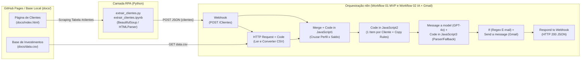

# 🏗️ 06 — Arquitetura da Solução e Contratos de Dados

> **Navegação:** [⬅️ Anterior: 05 — Glossário Técnico](./05-glossario.md) | [📚 Índice da Documentação](./README.md) | [Próximo: 07 — Validação e Testes ➡️](./07-validacao-e-testes.md)

---

## 1. Visão Arquitetural Ponta a Ponta




---

## 2. Contratos de Dados JSON entre as Etapas

### 2.1. Contrato 1: Saída do Python RPA $\rightarrow$ Entrada do `Webhook` (`POST /Clientes`)
```json
{
  "clientes": [
    {
      "nome": "Ana Silva",
      "email": "ana@email.com",
      "saldo": "R$ 12.500,00",
      "perfil": "Conservador"
    }
  ]
}
```

### 2.2. Contrato 2: Saída do `Code in JavaScript` (Parser do `data.csv`)
```json
{
  "investimentos": [
    {
      "perfil": "Conservador",
      "produto": "CDB Liquidez Diária",
      "minimo": 1000,
      "rentabilidade": "12.5%"
    }
  ]
}
```

### 2.3. Contrato 3: Saída do `Code in JavaScript2` (1 Item por Cliente para a OpenAI)
```json
{
  "email_to": "ana@email.com",
  "nome": "Ana Silva",
  "perfil": "Conservador",
  "saldo_texto": "R$ 12.500,00",
  "saldo_num": 12500,
  "recomendacao": "CDB Liquidez Diária",
  "motivo": "Produto alinhado ao perfil Conservador com aporte mínimo de R$ 1000 compatível com o saldo de R$ 12.500,00 (rentabilidade: 12.5%).",
  "mensagem_base": "Olá, Ana Silva! Para o seu perfil Conservador, priorizamos segurança e liquidez em renda fixa. Recomendamos o produto CDB Liquidez Diária (rentabilidade de referência: 12.5%).",
  "copy_rules": {
    "idioma": "pt-BR",
    "tom": "amigável e profissional",
    "tamanho": "curto (4-6 linhas)",
    "evitar": ["promessas de ganho", "garantias", "linguagem agressiva"]
  }
}
```

### 2.4. Contrato 4: Saída do `Code in JavaScript3` (Pós-OpenAI / Guardrail)
```json
{
  "email_to": "ana@email.com",
  "email_valido": true,
  "nome": "Ana Silva",
  "perfil": "Conservador",
  "saldo_texto": "R$ 12.500,00",
  "saldo_num": 12500,
  "recomendacao": "CDB Liquidez Diária",
  "motivo": "Produto alinhado ao perfil Conservador com aporte mínimo de R$ 1000 compatível com o saldo de R$ 12.500,00 (rentabilidade: 12.5%).",
  "subject": "Recomendação de Investimento (Conservador): CDB Liquidez Diária",
  "text_body": "Olá, Ana Silva! Com base no seu perfil Conservador e saldo de R$ 12.500,00...",
  "html_body": "<p>Olá, <strong>Ana Silva</strong>!</p><p>...</p>",
  "modo_geracao": "ia_generativa_openai"
}
```
