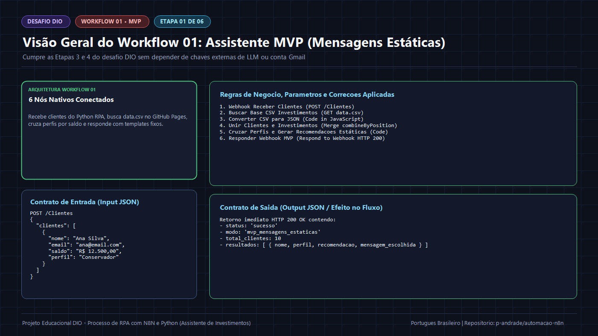
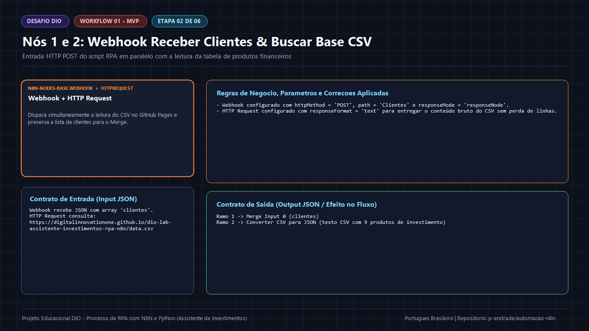
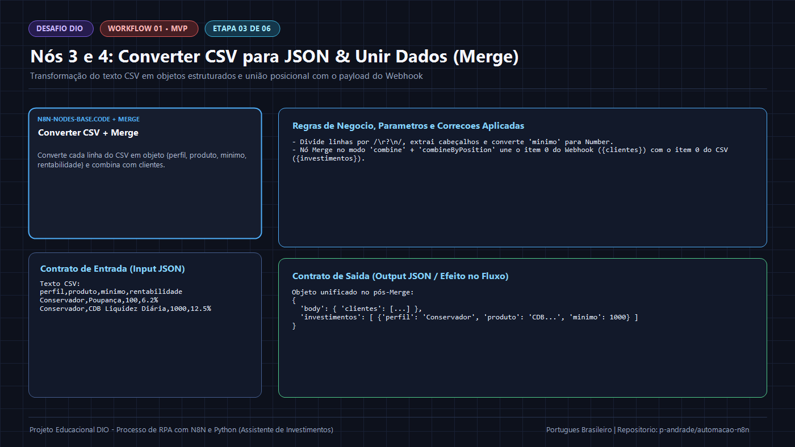
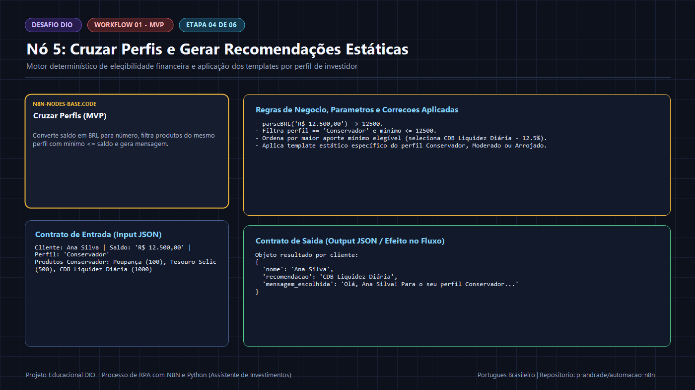
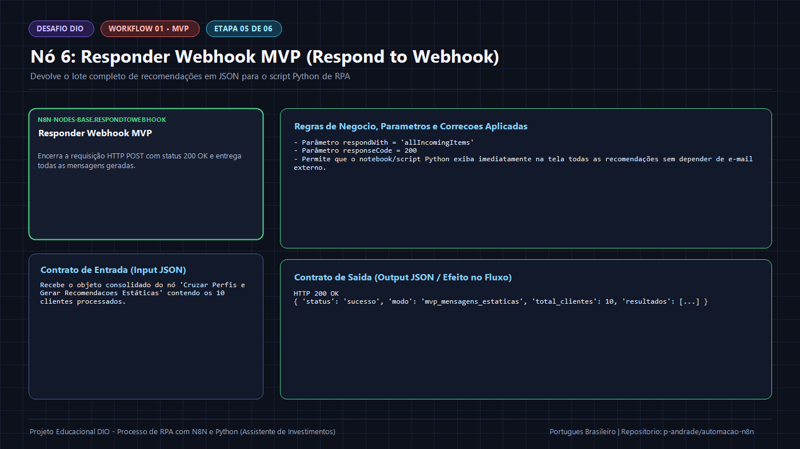

# ⚙️ Workflow 01 — Assistente de Investimentos RPA (MVP Mensagens Estáticas)

> **Navegação:** [🏠 README Principal](../../README.md) | [⚙️ Índice de Workflows](../README.md) | [Próximo: Workflow 02 (IA + Gmail) ➡️](../02-assistente-investimentos-ia-gmail/README.md)

---

## 📌 Objetivo deste Workflow

Cumpre integralmente as **Etapas 3 e 4 (MVP)** do desafio oficial da DIO: recebe a lista de clientes extraída pelo script Python de RPA via `POST /Clientes`, baixa a base `data.csv`, cruza o perfil e o saldo de cada cliente com os aportes mínimos e devolve imediatamente o JSON com as mensagens estáticas recomendadas, **sem exigir credenciais da OpenAI ou do Gmail**.

---

## 🖼️ Galeria Passo a Passo (6 Lâminas Didáticas)

### 1. Visão Geral do MVP

### 2. Nós 1 e 2: Webhook Receber Clientes & Buscar Base CSV

### 3. Nós 3 e 4: Converter CSV para JSON & Unir Clientes e Investimentos (Merge)

### 4. Nó 5: Cruzar Perfis e Gerar Recomendações Estáticas

### 5. Nó 6: Responder Webhook MVP

### 6. Fluxo Completo do Workflow 01 (MVP)

