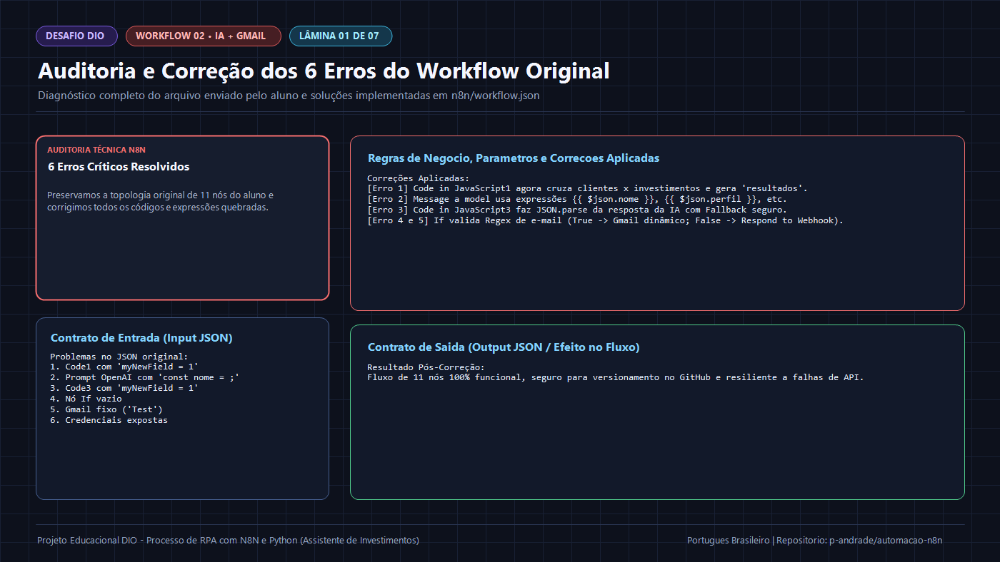
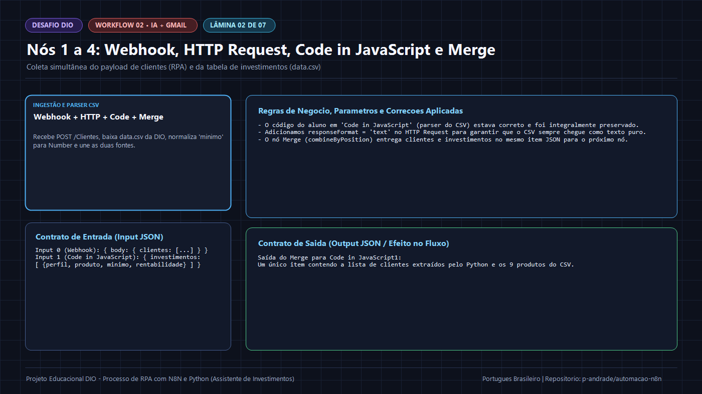
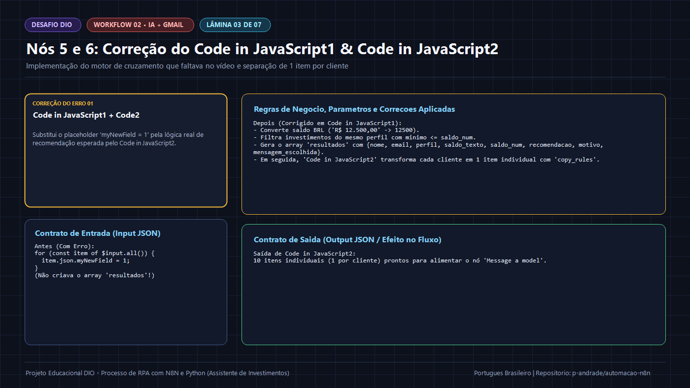
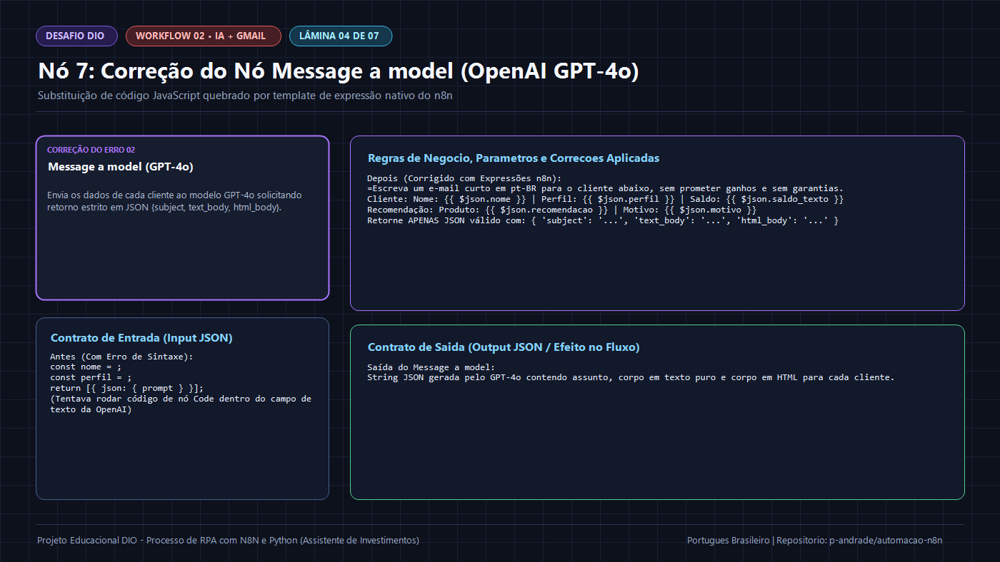
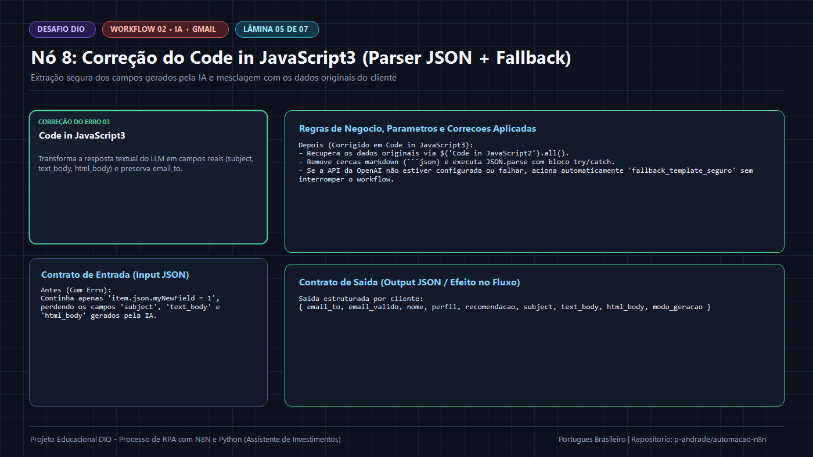
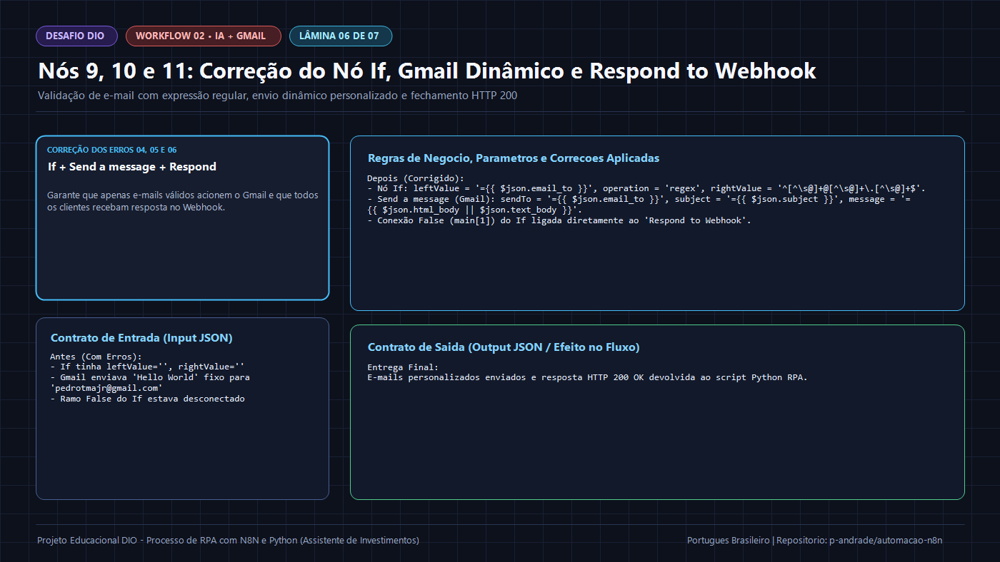

# 🚀 Workflow 02 — Assistente de Investimentos Completo Corrigido (IA GPT-4o + Gmail)

> **Navegação:** [🏠 README Principal](../../README.md) | [⚙️ Índice de Workflows](../README.md) | [🛠️ Diagnóstico Forense dos 6 Erros](../../docs/03-diagnostico-e-correcao-erros.md)

---

## 📌 Objetivo deste Workflow

Esta é a versão **100% corrigida e validada** do workflow de **11 nós** construído pelo aluno para a **Etapa 5 (Desafio Completo com IA Generativa)** da DIO. O arquivo JSON exportável está disponível tanto em [`workflows/02-assistente-investimentos-ia-gmail/workflow.json`](./workflow.json) quanto no caminho padrão exigido pela DIO em [`n8n/workflow.json`](../../n8n/workflow.json).

---

## 🖼️ Galeria Passo a Passo das Correções (7 Lâminas Didáticas)

### 1. Auditoria e Correção dos 6 Erros do Workflow Original

### 2. Nós 1 a 4: Webhook, HTTP Request, Code in JavaScript e Merge

### 3. Nós 5 e 6: Correção do `Code in JavaScript1` (Cruzamento) & `Code in JavaScript2` (Split)

### 4. Nó 7: Correção do Prompt Dinâmico no `Message a model` (`OpenAI GPT-4o`)

### 5. Nó 8: Correção do `Code in JavaScript3` (Parser JSON + Guardrail + Fallback)

### 6. Nós 9, 10 e 11: Correção do Nó `If` (Regex), `Send a message` (Gmail) e `Respond to Webhook`

### 7. Diagrama Completo do Workflow 02 Corrigido (11 Nós)

